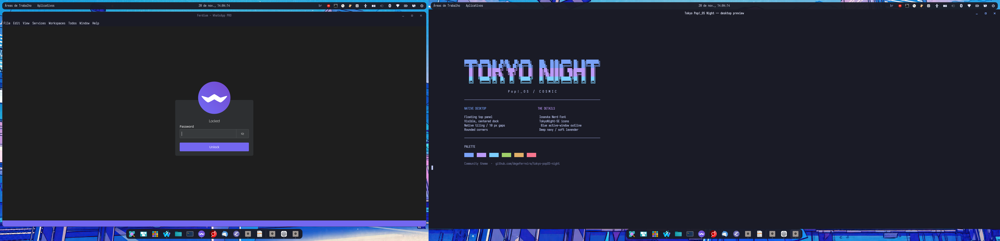

<p align="center">
  
</p>

# Tokyo Pop!_OS Night

[Português](README.md)



Deep blues and lilac. **Tokyo Night** meets COSMIC.

- Slim floating panel and an always-visible dock.
- Iosevka Nerd Font and TokyoNight-SE icons.
- Blue 2 px focus border and 10 px tiling gaps.
- Native transparency and matching colors.

Wallpaper, shortcuts, and shell preserved. Terminal styling is **Kitty-only**. Other terminals keep their settings. If missing, the installer warns and optionally offers installation and default-terminal setup.

**Install:** Pop!_OS 24.04 with COSMIC and Python 3.12+. Run without `sudo`. Fonts/icons download on first use; automatic backup.

```sh
git clone https://github.com/degeferreira/tokyo-popOS-night.git
cd tokyo-popOS-night
python3 theme.py apply
```

**Restore**, from the project folder:

```sh
python3 theme.py restore
```

[Advanced guide (Portuguese)](docs/advanced.md) · [Credits / Créditos](ATTRIBUTION.md) · [MIT](LICENSE)
