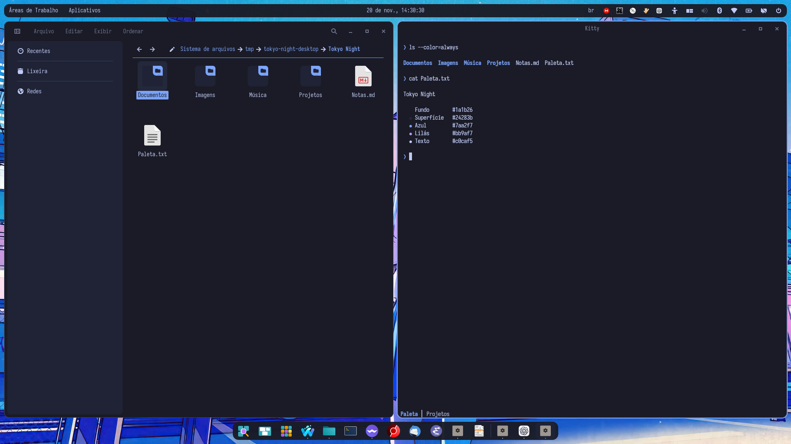

<p align="center">
  
</p>

# Tokyo Pop!_OS Night

[Português](#português) · [English](#english)



## Português

Azul profundo, lilás na medida e espaço para respirar. O clima do **Tokyo Night** no COSMIC.

- Painel fino e flutuante, dock sempre visível.
- Iosevka Nerd Font e ícones TokyoNight-SE.
- Borda azul de 2 px e mosaico com espaçamento de 10 px.
- Listas, seleções e abas do Kitty na mesma paleta.

Papel de parede, atalhos e shell continuam seus.

**Instalar:** Pop!_OS 24.04 com COSMIC e Python 3.12+. Execute sem `sudo`; fontes e ícones são baixados na primeira aplicação. Backup automático.

```sh
git clone https://github.com/degeferreira/tokyo-popOS-night.git
cd tokyo-popOS-night
python3 theme.py apply
```

**Restaurar**, na pasta do projeto:

```sh
python3 theme.py restore
```

[Opções, compatibilidade e backups](docs/advanced.md)

## English

Deep blues, a touch of lilac, and room to breathe. **Tokyo Night** meets COSMIC.

- Slim floating panel and an always-visible dock.
- Iosevka Nerd Font and TokyoNight-SE icons.
- Blue 2 px focus border and 10 px tiling gaps.
- Matching lists, selections, and Kitty tabs.

Your wallpaper, shortcuts, and shell stay yours.

**Install:** Pop!_OS 24.04 with COSMIC and Python 3.12+. Run the installation commands above without `sudo`. Fonts and icons download on first use; settings are backed up automatically.

**Restore:** run `python3 theme.py restore` from the project folder.

[Advanced guide (Portuguese)](docs/advanced.md) · [Credits / Créditos](ATTRIBUTION.md) · [MIT](LICENSE)
