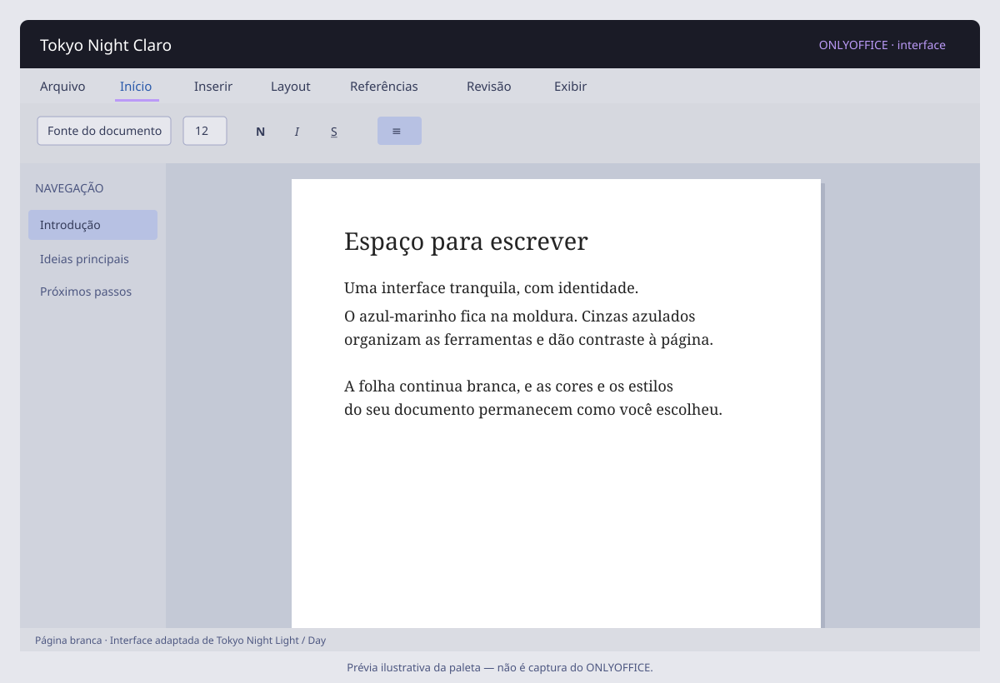

# Tokyo Night Day for ONLYOFFICE

[Português](README.md) · [Back to the COSMIC theme](../README.en.md)

An optional writing interface: navy `#1a1b26` top strip, blue-gray `#d6d8df`/`#dadce3` tools, `#b7c1e3` selection and blue/purple accents. Document pages remain white. Fonts, document formatting and content stay unchanged.

This add-on is **not** included in `theme.py apply`. It does not modify the system theme, terminal or default file associations.



The dark frame adds Night/Storm identity while the interface body remains light and the page stays `#ffffff`. This preview illustrates the palette; actual control positions depend on ONLYOFFICE.

## Install

Requires Linux, Python 3.12+ and ONLYOFFICE Desktop Editors with local theme support (8.0+). Configuration checked with Flatpak 9.4.0; native installations share the format but were not visually tested.

Save your work and close ONLYOFFICE normally. From the repository root, without `sudo`:

```sh
python3 onlyoffice/install.py install
```

Reopen ONLYOFFICE and go to **Settings → General → Interface theme**. Use **Add local theme**, choose this folder’s [tokyo-night-day.json](tokyo-night-day.json), then select **Tokyo Night Day**. When updating, reimport the file even if the theme is already listed. This UI step applies the editor color layer; copying the JSON and writing the native preference are insufficient in some versions, including the tested 9.4 release. Flatpak profiles are detected first. Select a target explicitly if needed:

```sh
python3 onlyoffice/install.py install --target flatpak
python3 onlyoffice/install.py install --target native
```

The JSON is copied into the user's `onlyoffice/desktopeditors/uithemes/` data folder. Selection changes only `UITheme` in `onlyoffice/DesktopEditors.conf`. Flatpak stores these below `~/.var/app/org.onlyoffice.desktopeditors/`. Application files and Flatpak permissions remain untouched.

## Manual import

Choose **Settings → General → Interface theme → Add local theme** and select [tokyo-night-day.json](tokyo-night-day.json). It can also be selected under **View → Interface Theme**. Menu names depend on version/language. To copy the JSON without selecting it:

```sh
python3 onlyoffice/install.py install --no-select
```

## Restore

Close ONLYOFFICE normally, then run:

```sh
python3 onlyoffice/install.py restore
```

Reopen the app. Backups are stored in `${XDG_STATE_HOME:-~/.local/state}/tokyo-night-onlyoffice/backups/`. Only the theme JSON and selection are restored; other preferences survive. Later edits to the JSON or selection are preserved. File associations are unaffected.

## Default DOCX/DOC app (optional)

For Flatpak:

```sh
xdg-mime default org.onlyoffice.desktopeditors.desktop application/vnd.openxmlformats-officedocument.wordprocessingml.document
xdg-mime default org.onlyoffice.desktopeditors.desktop application/msword
```

Native packages require their installed `.desktop` identifier. This step is independent of theme installation.

## Sources and scope

Uses the [official theme format](https://api.onlyoffice.com/docs/desktop-editors/usage-api/customizing-themes/), [local theme import](https://helpcenter.onlyoffice.com/desktop/getting-started), and native [CThemes loader](https://github.com/ONLYOFFICE/desktop-apps/blob/master/win-linux/src/cthemes.cpp). Adapted from [original Tokyo Night Light](https://github.com/tokyo-night/tokyo-night-vscode-theme/blob/master/themes/tokyo-night-light-color-theme.json) and [Tokyo Night Day](https://github.com/folke/tokyonight.nvim), with a Night/Storm top strip. This is an adaptation, not an official variant or exact copy; no upstream source code is bundled. The repository's MIT license applies to this add-on; ONLYOFFICE retains its own license and trademarks.

Plugins, OS dialogs and future versions may use their own colors. Printed/exported document colors are not changed. Document transparency is not provided.

The native `UITheme` selection stores the installed JSON’s absolute path, matching native import. A filename alone may leave the editor on its default theme. The web editor also caches its colors, so activating the theme through the UI is an explicit installation step. Do not delete the cache to apply the theme. If the option is missing, choose **Add local theme** and import the JSON from this repository folder.

Native document tabs use a `#24283b` strip, a `#1a1b26` active tab and white titles in every state. When updating the JSON with documents open, use **Add local theme** to reimport this folder’s file. Selecting the already listed theme can reuse its previous in-memory definition. Reimporting updates it without closing documents.
