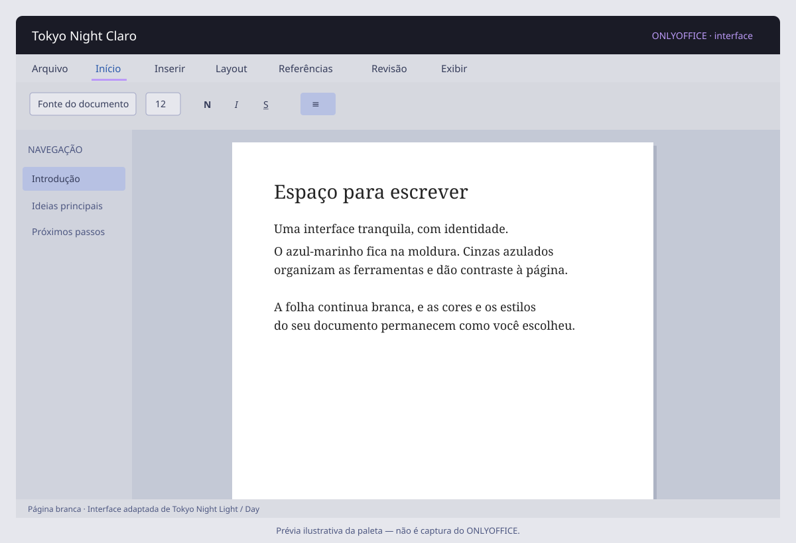

# Tokyo Night Claro para ONLYOFFICE

[English](README.en.md) · [Voltar ao tema COSMIC](../README.md)

Um complemento opcional para escrever: faixa superior azul-marinho `#1a1b26`, ferramentas em cinza-azulado `#d6d8df`/`#dadce3`, seleção `#b7c1e3` e detalhes azuis e lilás. A página continua branca; o tema não muda fontes, estilos, cores ou conteúdo dos documentos.

Não faz parte de `theme.py apply`. Não altera o tema do sistema, o terminal ou as associações de arquivos.



A moldura escura traz a identidade Night/Storm; o corpo da interface fica claro, sem o branco dominante da versão anterior. A página é sempre `#ffffff`. A prévia acima ilustra a paleta; o posicionamento real dos controles depende do ONLYOFFICE.

## Instalar

Requisitos: ONLYOFFICE Desktop Editors com suporte a temas locais (8.0+), Linux e Python 3.12+. Configuração verificada no Flatpak 9.4.0; instalações nativas usam o mesmo formato, mas não foram verificadas visualmente.

Salve seus documentos e feche normalmente o ONLYOFFICE antes de instalar. Na raiz deste repositório, sem `sudo`:

```sh
python3 onlyoffice/install.py install
```

Abra novamente o ONLYOFFICE e vá a **Configurações → Geral → Tema da interface**. Use **Adicionar tema local**, escolha [tokyo-night-day.json](tokyo-night-day.json) desta pasta e selecione **Tokyo Night Claro / Tokyo Night Day**. Ao atualizar, reimporte o arquivo mesmo que o tema já esteja listado. Essa seleção pela interface é necessária para aplicar as cores na camada do editor; gravar a preferência nativa e copiar o JSON não bastam em algumas versões, incluindo a 9.4 testada. O instalador detecta o perfil Flatpak primeiro; para escolher explicitamente:

```sh
python3 onlyoffice/install.py install --target flatpak
# ou, para pacote nativo/AppImage:
python3 onlyoffice/install.py install --target native
```

O JSON vai para `onlyoffice/desktopeditors/uithemes/` dentro dos dados do usuário; a seleção usa a chave `UITheme` do arquivo `onlyoffice/DesktopEditors.conf`. O Flatpak guarda ambos sob `~/.var/app/org.onlyoffice.desktopeditors/`. Nenhum arquivo interno do aplicativo é modificado, nem é necessário liberar permissões adicionais ao Flatpak.

## Importação manual

Em **Configurações → Geral → Tema da interface → Adicionar tema local**, escolha [tokyo-night-day.json](tokyo-night-day.json). Também pode selecioná-lo em **Exibir → Tema da interface**. Os nomes dos menus variam com o idioma/versão. Para copiar sem selecionar automaticamente:

```sh
python3 onlyoffice/install.py install --no-select
```

## Restaurar

Feche normalmente o ONLYOFFICE e execute:

```sh
python3 onlyoffice/install.py restore
```

Reabra o aplicativo. O backup fica em `${XDG_STATE_HOME:-~/.local/state}/tokyo-night-onlyoffice/backups/`. Apenas o JSON do tema e a seleção anterior são recuperados; outras preferências são preservadas. Se o JSON ou a seleção tiverem sido alterados depois, o instalador preserva essas edições. A restauração não muda associações de arquivos.

## Abrir DOCX e DOC por padrão (opcional)

Para a versão Flatpak, se desejar:

```sh
xdg-mime default org.onlyoffice.desktopeditors.desktop application/vnd.openxmlformats-officedocument.wordprocessingml.document
xdg-mime default org.onlyoffice.desktopeditors.desktop application/msword
```

Para pacote nativo, use o identificador `.desktop` instalado pela sua distribuição. Esse passo é independente do tema.

## Referências e limites

Formato baseado na [documentação oficial de temas](https://api.onlyoffice.com/docs/desktop-editors/usage-api/customizing-themes/) e no carregador nativo [CThemes](https://github.com/ONLYOFFICE/desktop-apps/blob/master/win-linux/src/cthemes.cpp). A [importação local](https://helpcenter.onlyoffice.com/desktop/getting-started) é oferecida pelo próprio aplicativo. Adaptação das cores de [Tokyo Night Light original](https://github.com/tokyo-night/tokyo-night-vscode-theme/blob/master/themes/tokyo-night-light-color-theme.json) e [Tokyo Night Day](https://github.com/folke/tokyonight.nvim), com a faixa superior do Night/Storm. Não é uma variante oficial nem uma cópia exata; não redistribui o código desses projetos. Mantém a licença MIT do repositório; ONLYOFFICE conserva seus próprios termos e marcas.

O tema cobre a interface nativa e os editores que respeitam os papéis oficiais de cores. Plugins, diálogos do sistema e futuras versões podem usar cores próprias. Não altera páginas impressas/exportadas, nem oferece transparência para documentos.

A seleção nativa `UITheme` usa o caminho absoluto do JSON instalado, como faz a importação nativa. O nome do arquivo sozinho pode deixar o editor no tema padrão. Além disso, o editor web mantém seu próprio cache de cores: por isso a ativação pela interface é um passo explícito deste guia. Não apague o cache para tentar aplicar o tema. Se a opção não aparecer, use **Adicionar tema local** e importe o JSON desta pasta do repositório.

As abas nativas usam faixa `#24283b`, aba ativa `#1a1b26` e títulos brancos em todos os estados. Ao atualizar o JSON com documentos abertos, use **Adicionar tema local** para reimportar o arquivo desta pasta; apenas selecionar o tema já listado pode reutilizar a definição anterior em memória. Isso permite atualizar sem fechar documentos.
